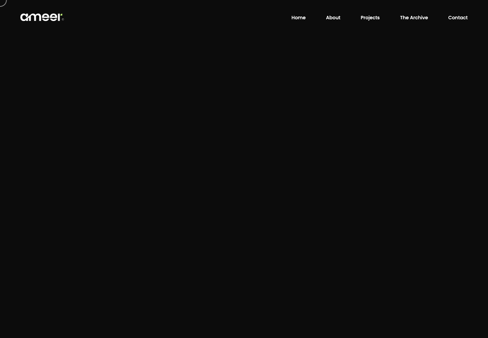

# Ameer Bamigbayan — June 12, 2026

A Next.js reconstruction of **ameerbamigbayan.com**, using [D-j-View](https://github.com/Nuel-osas/D-j-View) and the Internet Archive. The homepage comes from the [June 12, 2026 capture at 23:29:24 UTC](https://web.archive.org/web/20260612232924/https://ameerbamigbayan.com/).

Fifteen native App Router pages preserve the portfolio's oversized Six Caps typography, Poppins body text, project imagery, responsive layouts, overlapping project cards, gallery, and scroll animations. Images, fonts, video, styles, and visual dependencies are served locally.



## Run locally

Use Node.js 24 (see `.nvmrc`).

```sh
npm ci
npm run dev -- --port 3001
```

Open http://localhost:3001. For a production preview:

```sh
npm run build
npm start -- --port 3001
```

## Historical sources

The homepage and contact page have exact June 12 snapshots. Other routes use available nearby captures; the ChartReel capture is shortly after midnight on June 13, and Talcube Learn is available only from 2025. These pages are a reconstruction around the requested date, not a claim that every route was archived that day.

| Route                     | Capture timestamp (UTC) |
| ------------------------- | ----------------------- |
| `/`                       | 2026-06-12 23:29:24     |
| `/contact/`               | 2026-06-12 23:00:16     |
| `/about-me/`              | 2026-04-22 08:07:56     |
| `/projects/`              | 2026-05-08 08:59:50     |
| `/the-archive/`           | 2026-05-08 08:51:28     |
| `/project/chartreel/`     | 2026-06-13 00:39:00     |
| `/project/coca-cola/`     | 2026-04-22 08:39:39     |
| `/project/damfe/`         | 2026-04-22 08:09:44     |
| `/project/danfo/`         | 2026-03-14 14:06:07     |
| `/project/havit/`         | 2026-05-08 07:42:33     |
| `/project/jobbox/`        | 2026-03-14 14:12:30     |
| `/project/kolomoni/`      | 2026-04-22 08:16:29     |
| `/project/the-swamp/`     | 2026-03-14 13:51:27     |
| `/project/wizkid/`        | 2026-04-22 08:20:41     |
| `/project/talcube-learn/` | 2025-08-05 02:12:23     |

Exact source URLs are in [the source manifest](docs/source-manifest.json). The source site's displayed 2025 copyright and project dates are preserved.

D-j-View captured the archived homepage and 118 supporting resources. Related page HTML was retrieved separately from Wayback. Supporting assets were recovered from their original URLs when archived files were unavailable, including the resources collected by D-j-View. The historical version of every stylesheet, font, image, and vendor script cannot therefore be independently guaranteed. [The asset manifest](docs/asset-manifest.json) records URLs, recovery method, sizes, and SHA-256 checksums of the local files.

Twenty-five unavailable Roboto/Roboto Slab font URLs in the source referenced `new.ameerbamigbayan.com`. Their broken font declarations were removed so the original fallback stack can render. The visible Six Caps and Poppins families are available locally.

## Behavior and implementation

- Editable TSX components are statically generated by Next.js; page-specific metadata and styles follow the captured routes.
- The original Montoya visual scripts and their local dependencies drive the gallery, project filters, custom scrolling, reveals, and cursor effects. Native document navigation resets that document-scoped runtime between pages.
- The source script that assumed every page had a background video was replaced with a guarded initialization. The original contact, analytics, and tracking integrations are omitted.
- Menus expose expanded state and support Escape; filters and gallery buttons support keyboard input. Reduced-motion mode presents a static gallery grid and readable sections. Server-rendered content remains available without JavaScript.
- The contact form validates locally and reports that a message has **not been sent or stored**. It has no backend. External portfolio and social links retain their original destinations.

This is an independent historical reconstruction. Original portfolio content, artwork, fonts, theme code, and third-party libraries retain their respective owners' rights and license notices; no ownership or license over those materials is asserted here.

## Validation

```sh
npm run build
npm run typecheck
npx playwright-core install chromium
npm run test:browser
```

The browser suite starts and stops its own production server. It checks every route on desktop, mobile, and with reduced motion; loaded images and local resources; JavaScript errors; responsive width; navigation controls; project filters; gallery controls; and contact feedback. It also checks content without JavaScript. Set `CHROME_PATH` for an existing Chrome installation, `BASE_URL` to test a running preview, or `SCENARIO=desktop` to select one scenario.

GitHub Actions runs the build and browser suite and uploads screenshots and JSON results. Local raw captures and QA artifacts are ignored under `.site-capture/`.

Desktop (1440 × 1000) and mobile (390 × 844) homepage hero screenshots were compared against the D-j-View capture after its animations settled. Pixelmatch found zero changed pixels at threshold 0.15 with antialiasing excluded. This comparison covers those two hero views, not every section or route, and the capture itself has the asset-version limitations described above.

## Structure

- `src/app/` — App Router layouts, static routes, and metadata
- `src/components/pages/` — page content in TSX
- `src/components/shared/` — navigation, footer variants, and preloader
- `src/components/SiteRuntime.tsx` — visual runtime initialization
- `src/lib/controls.ts` — accessible controls and static-mode behavior
- `public/assets/` and `public/styles/` — local visual assets and styles
- `scripts/verify.mjs` — production browser checks
- `docs/` — provenance and previews
